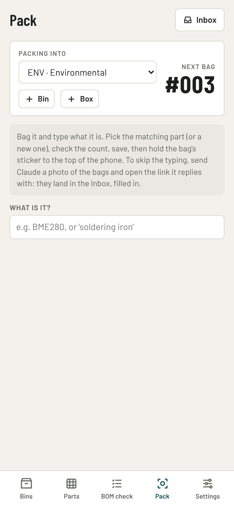
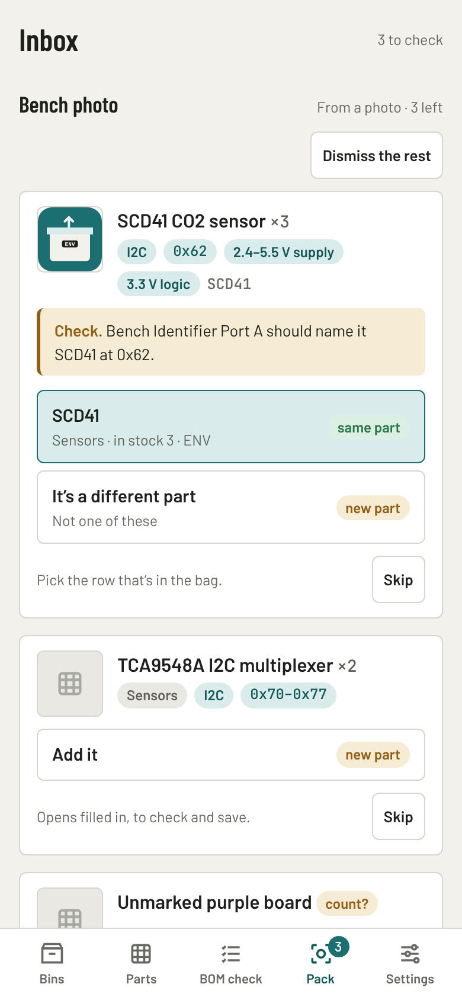
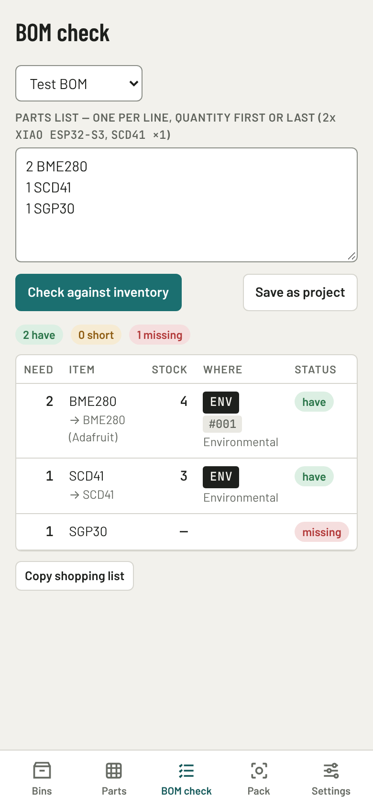
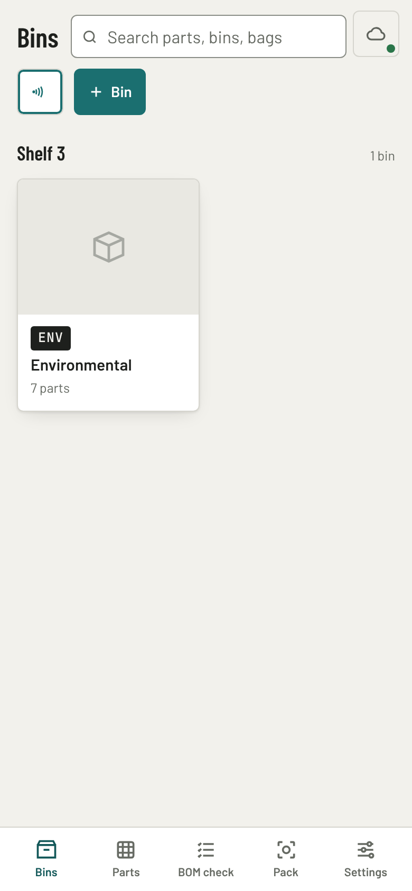

# Parts Bin

**Use it: [parts-bin.junkdrawer.works](https://parts-bin.junkdrawer.works/)**

**A parts inventory for a maker's workroom, with the NFC tags written and read right in the page.** Bins, moving boxes and numbered bags, a search over everything, and a BOM check that says what you have, what you're short of and where it is. Log a bag and tag it in one go: save the part, hold the sticker to the top of the phone, next bag. Or skip the typing: send Claude a photo and open the link it replies with.

<p align="center">
  
  
  
  
</p>

## How it works

- **Pack.** Pick the bin or box you're filling, type what's in the bag and pick the match (or a new part), check the count, save. A part that's already in a bag keeps its number, so the sticker on that bag still opens it. A second bag of it is *It's another bag of it* under the part: a new entry with the same details, its own number, sticker and count. For a new bag, the tag screen opens already listening: hold a blank sticker to the phone and it gets that bag's link. The next bag number is waiting, and under the field are the last five bags packed into that box, with Tag on any whose sticker isn't written yet. A bag still waiting for its tag (one that failed and was skipped) says so on its page, and Parts › *Bag tag not written* lists them all in bag order.
- **Tap a tag to find a bag.** While Parts Bin is open it listens for tags, so holding any bag or bin sticker to the phone opens it right here. (The first time, tap the tag button by the search box to allow NFC; after that it starts by itself.) Hold one tag after another and Back still goes straight to where you were before the first. To move a bag, tap Move on its page and pick a bin from the ones used lately, or hold the bin's sticker to the phone. Tags written by the old Stockroom artifact open here too, with an offer to rewrite them so they open Parts Bin even when the page is closed; tick *Don't ask again* and each old tag held is rewritten straight away.
- **One bag, one number.** Two devices numbering bags before they've synced can give out the same number. When that happens, Bins, Parts and Pack say so, Parts › *Bag numbers to sort out* lists both parts (the one with the tag first, as its sticker carries the number) and the numbers no part has, and the other part's page gives it the next number and writes its tag. A tag for a number on two parts opens the one with the tag.
- **BOM check.** Paste a parts list (typed, from a guide, or an export from KiCad, a Digi-Key or Mouser cart, or Fritzing), or pick a saved one, and get have / short / missing with where each part lives. A part that may be the wrong one (a 10k resistor for a 1k) says *check*. Tap a count to see only those lines. Copy a shopping list, or a pick list grouped by bin with bag numbers to gather the parts, and after the build, *Built it* takes them out of stock (with Undo). A saved BOM can be saved over, saved as new, renamed or deleted.
- **Low stock.** Give a part a reorder level and it's low once its count gets there. Bins lists the low parts under *Not in a bin*, each bin's and box's tile counts its own, and Parts › *Low stock* copies a reorder list: one line a part, with what's left, the reorder level, its part number and link. Parts used up with no reorder level are under *Out of stock*.
- **Boxes for a move.** A box is a container like a bin; each part remembers which bin it came out of. A box page lists its bags in number order, puts each one back where it came from with a tap, or as you hold its tag to the phone (with Undo), and prints its packing list. To split or reorganise a bin or a box, *Move parts* on its page puts a tick on each row and moves the ticked ones in one go.
- **A spreadsheet of it all.** Settings › *Save as a spreadsheet (CSV)* saves one row a part, by bin and bag, with every detail, for a move, an insurance list or a club. It opens in Excel with Ω and ₂ as typed, and a cell starting with = is shown as text, not run. Only the backup file loads back in.
- **Same on every device.** Turn on Google Drive in Settings and the inventory is saved to a "Parts Bin" folder in your Drive and merged part by part with your other devices. Without it, everything stays in this browser. A part or bin deleted by mistake comes back with Undo on the message that says it's deleted (a bin with its parts in it), on every device.
- **Inbox: parts from a photo, a receipt or a link.** Send Claude a photo of the bags, an order email or a product page; it replies with a link that opens the Inbox (under Pack) with each part filled in. Tap a card, check it, **Save & tag**; a card skipped by mistake comes back with Undo. A part you already have is offered first, so it's bagged under its own record and no double is made (in Pack, *It's another bag of it* makes one on purpose, for a second bag). The Claude skill that does the reading is in [`skill/parts-bin-cataloger/`](skill/parts-bin-cataloger/SKILL.md).
- **Details, filled in for you.** The same inbox takes suggestions for parts you already have: category, interface, I2C address, supply and logic voltage, part number, a link and a reference photo of a typical one. Each suggestion is a card with a tick per field; nothing changes until you apply it. Parts with no details at all go to Claude from the Inbox 40 at a time, a category's together, so each reply can be worked through; this browser keeps count of how many have gone. Anything that can't be settled by looking is flagged "check before trusting it" with the test that settles it, and Parts' *Show* menu has a *To check* list for working through them, with Low stock and the other lists, each with how many are on it, above the categories. *Recently changed* has the parts changed in the last 7 days, newest first, to look over what a Pack session or a batch touched, and a part's page says when it was last changed.
- **Photo identification in the page, optional.** With your own Anthropic API key (Settings), Pack can identify the parts on a photo, several at once, and BOM check can match loose wording (a line Claude says isn't in your inventory shows as missing, not as the nearest guess). Each tap is one request, billed to your API account. The key stays in that browser. A part saved from a photo keeps a small picture cut from it, shown where a reference photo would be when it has none; a part's page has *Use my photo* and *Remove my photo* too.

NFC needs Chrome on Android. Everything else works in any browser.

### What's saved where

- **In this browser:** the inventory (localStorage), the API key if you add one, and your sign-in for Drive.
- **Your own photos of parts stay in that browser** (IndexedDB), about 10 KB each. They aren't synced to Drive or put in the backup file, so another device doesn't have them.
- **In your Google Drive, if you turn it on:** one file, `Parts Bin/Parts Bin.json`, with bins, parts and saved BOMs. junkdrawer.works can only see files it made. To take the permission back, remove junkdrawer.works under Third-party apps & services in your Google Account.
- **A batch from Claude waits in this browser** (the Inbox) until you save or dismiss what's in it. It isn't synced.
- **Reference photos load from the site they're on.** A part's reference photo is a link to a picture on a maker's or shop's site, so that site sees a request for the image (with no referrer). If the picture goes away, the part shows its icon again.
- **Nothing else leaves the page,** except photos and lists sent to Anthropic when you use identification, and a parts list you choose to share with Claude.

## Running it

It's a static site: plain HTML, CSS and JavaScript, with no build step.

```sh
npx http-server -p 8080 -c-1 .   # then open http://localhost:8080
npm test                         # merge rules, then the page in Chromium with a pretend NFC reader and Drive
SHOTS=1 npm test                 # the same, and regenerates the README phone shots (docs/phone-*.png)
node tools/screenshots.mjs       # og.png, which shows docs/phone-bom.png (run it after SHOTS=1 npm test)
node tools/make-icons.mjs        # PNG icons from icon.svg
```

GitHub Pages serves it from `main`, `/ (root)`.

### Files

- `index.html`, `css/app.css`: the page.
- `js/app.js`: the screens (bins, parts, BOM check, pack, settings) and the NFC tag writer and reader.
- `js/model.js`: the inventory document and the item-by-item merge; unit-tested in `test/model.test.mjs`.
- `js/store.js`: keeps it in localStorage and imports Stockroom exports and backups.
- `js/bom.js`: BOM check's reading of a parts list and matching each line against the inventory; unit-tested in `test/bom.test.mjs`.
- `js/csv.js`: the inventory as a spreadsheet (Settings › *Save as a spreadsheet*), safe to open in Excel; unit-tested in `test/csv.test.mjs`.
- `js/bags.js`: bag numbers on more than one part, numbers on none, and which part a bag's tag opens; unit-tested in `test/bags.test.mjs`.
- `js/inbox.js`: reads a batch from a link, a pasted code or a file, keeps only the fields it knows, and works out what a suggestion would change; unit-tested in `test/inbox.test.mjs`.
- `skill/parts-bin-cataloger/SKILL.md`: the Claude skill that turns photos, receipts and links into a batch. The script that builds the link is at the end of it, and the tests check that its links open here.
- `js/sync.js`: optional Google Drive saving, the junkdrawer.works way.
- `js/ai.js`: optional photo identification with your own API key.
- `js/photos.js`: your own photos of parts, cut from an identified photo or chosen on a part's page, kept in this browser.
- `test/e2e.mjs`, `test/fake-google.mjs`: drive the page with a pretend NFC reader, a stand-in Google Drive and a stand-in Anthropic API, and check `carry.js` at the page's real address.
- `test/fuzz.test.mjs`: many devices editing, deleting and syncing at random, with clocks set wrong, checked against the merge rules; and random batches from Claude, which must never break the Inbox.
- `tools/`: `make-icons.mjs` makes the PNG icons from `icon.svg`, and the maskable and iPhone ones from `icon-full-bleed.svg` (square, as the phone rounds the corners itself); `screenshots.mjs` makes `og.png` from the README phone shots.
- `fonts/`: Barlow, Barlow Condensed and JetBrains Mono, served from here so nothing loads from elsewhere (SIL Open Font License).
- `sw.js`, `manifest.webmanifest`, `icon*.png`, `icon.svg`: works offline and installs to the home screen.
- `CNAME`, `carry.js`: Parts Bin has its own address, parts-bin.junkdrawer.works, so it installs as its own app. It used to be at junkdrawer.works/parts-bin/, which forwards here (tags and links written there still work). A browser keeps each address's saves apart, so the first time it opens here `carry.js` brings the inventory over from the old address. If that missed (a poor connection), Settings › *From the old address* fetches it again and adds whatever isn't here, writing over nothing.
